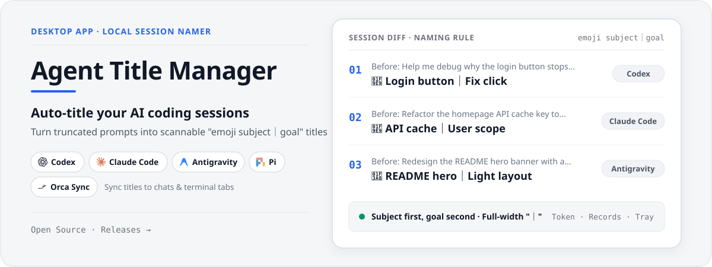
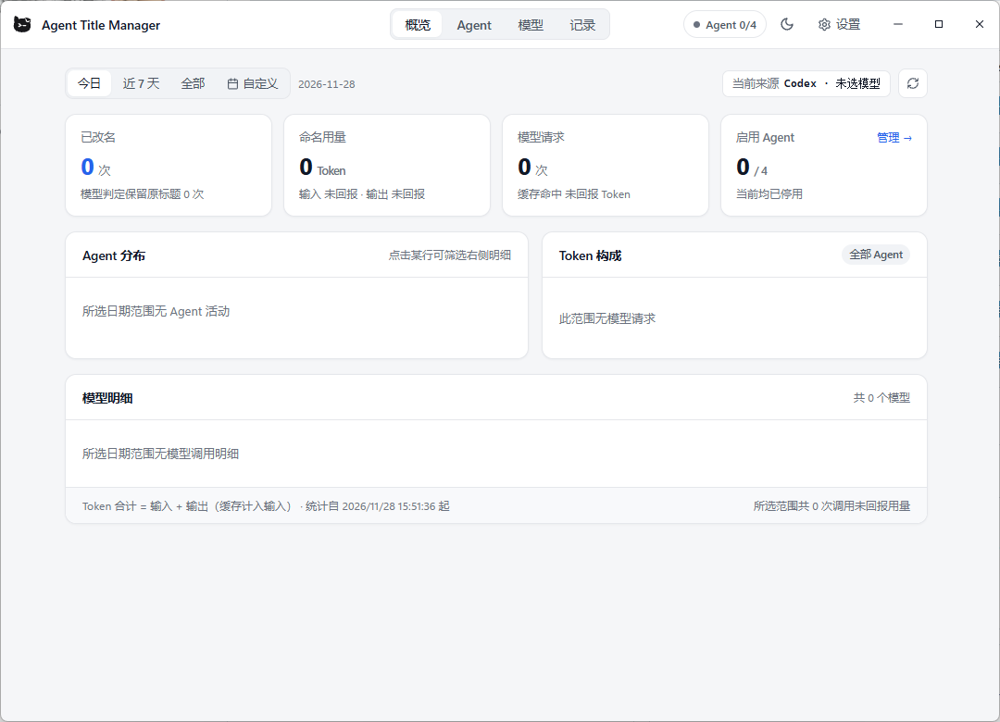
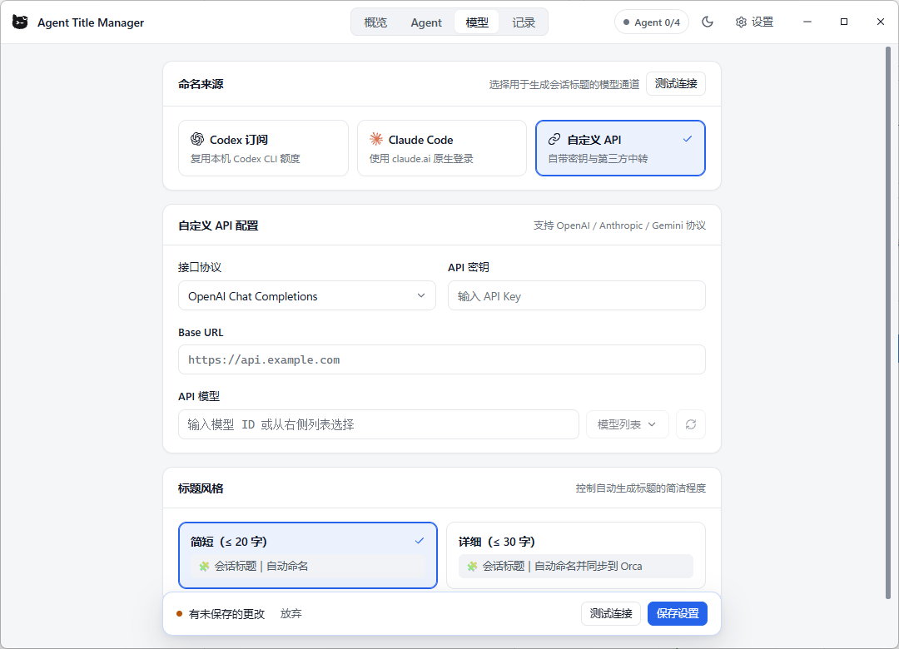
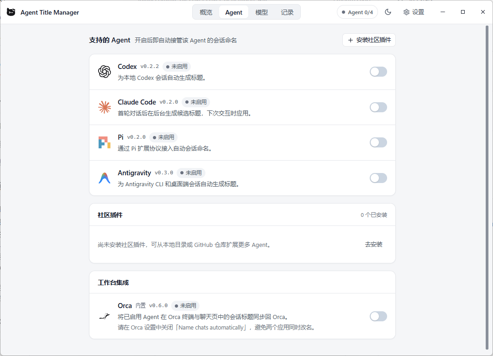

<p align="right">
  <strong>English</strong> · <a href="./README.zh-CN.md">简体中文</a>
</p>

<p align="center">
  
</p>

Agent Title Manager is a desktop app that automatically generates structured, scannable session titles (`emoji subject｜goal`) for **Codex**, **Claude Code**, **Antigravity** (desktop & CLI), and **Pi**, with optional **Orca** sync and local usage tracking.

<p align="center">
  <a href="https://github.com/yyxxd/agent-title-manager/releases/latest">
    
  </a>
</p>

<p align="center">
  
</p>

## Quick Start

### 1. Download & Install

Download the installer (`AgentTitleManager-*-windows-x64-setup.exe` for Windows x64; cross-platform builds planned) from the [**Latest Release**](https://github.com/yyxxd/agent-title-manager/releases/latest) (or browse [all releases](https://github.com/yyxxd/agent-title-manager/releases)), run it, and launch **Agent Title Manager** from the Start Menu.

> Requires **Microsoft Edge WebView2 Runtime**. The Node.js runtime is bundled with the installer.

### 2. Choose a Naming Model

Open the **Models** page and choose **Codex**, **Claude Code**, or a **Custom API**, then select a model and click **Test Connection**.
- Native subscriptions reuse your local CLI login state.
- Custom APIs support OpenAI Chat Completions, OpenAI Responses, Anthropic Messages, or Gemini with your own Base URL and key.

<p align="center">
  
</p>

### 3. Enable Your Agents

Open the **Agent** page and enable the tools you want to auto-title:
- **Codex**: if prompted to approve hooks, run `/hooks` in Codex, approve, then start or reopen a session.
- **Claude Code**: titles are generated in the background after the first turn and applied on the next message or reopen.
- **Orca (optional)**: enable workspace sync in **Integrations** to update matching Orca chats and terminal tabs.

<p align="center">
  
</p>

Closing the window minimizes the app to the system tray; quit from the tray menu or **Settings**.

---

<details>
<summary>Usage Metrics & Auto-Updates</summary>

- **Overview metrics**: shows local-date renames and known token usage (input + output, with cache counted in input). Calls without reported usage are counted separately. Connection tests are excluded from naming token totals.
- **In-app updates**: checks the latest stable GitHub release in the background and verifies the Ed25519 signature manifest and installer SHA-256 before updating (see [`docs/update-signing.md`](./docs/update-signing.md)). Exit from the tray before manual over-install; disable enabled adapters before uninstalling.

</details>

<details>
<summary>Build from Source (Windows x64)</summary>

Requires Go 1.26+, Node.js 22+, pnpm 11, an official Node.js Windows x64 extracted directory (`node.exe` + `LICENSE`), and NSIS 3.x:

```powershell
.\packaging\build.ps1 -NodeDistribution C:\tools\node-win-x64 -MakeNsis C:\tools\nsis\makensis.exe
```

- Outputs are staged under `out\windows-x64-*` and `out\AgentTitleManager-<version>-windows-x64-setup.exe` (version from `internal/desktop/version.txt`).
- To update the app icon, replace `internal/desktop/icon.png` and run `go generate ./cmd/atm`, committing both architecture `.syso` files and `packaging/app.ico`.
- Set an absolute `ATM_DATA_DIR` for both desktop and bridge to isolate SQLite, WebView2 data, and named pipes during testing; sandbox installer tests can use `setup.exe /S /NoIntegration /D=C:\temp\atm-sandbox`.

</details>

<details>
<summary>Plugin Communication Protocol</summary>

- Adapters spawn `atm-bridge.exe rpc`, submit one UTF-8 JSON object on `stdin`, and read one response line on `stdout` (`{"ok":true,"result":...}` or `{"ok":false,"error":"..."}`).
- Protocol v1 naming methods are `event.submit`, `title.claim`, and `title.ack` (the bundled Codex adapter also sends `hook.observed`). Adapters should fall back to normal session flow if the desktop app is closed, disabled, or times out. Retry `ingress_busy:` sparingly; wait on `ingress_pending` without resubmitting.
- Community plugins can load from a local directory with `agent-title-plugin.json` or by specifying a GitHub repository and full commit SHA.

</details>

## License & Third-Party Notices

See [`plugins/THIRD_PARTY_NOTICES.md`](./plugins/THIRD_PARTY_NOTICES.md) and [`internal/engine/LICENSE.naming`](./internal/engine/LICENSE.naming).
