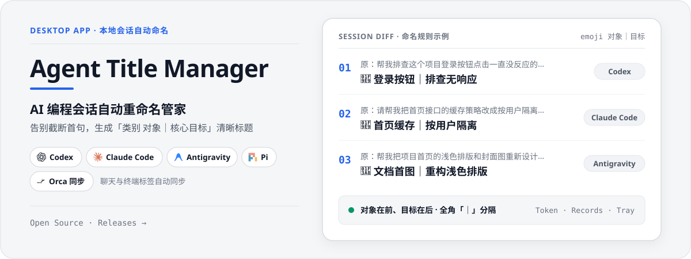
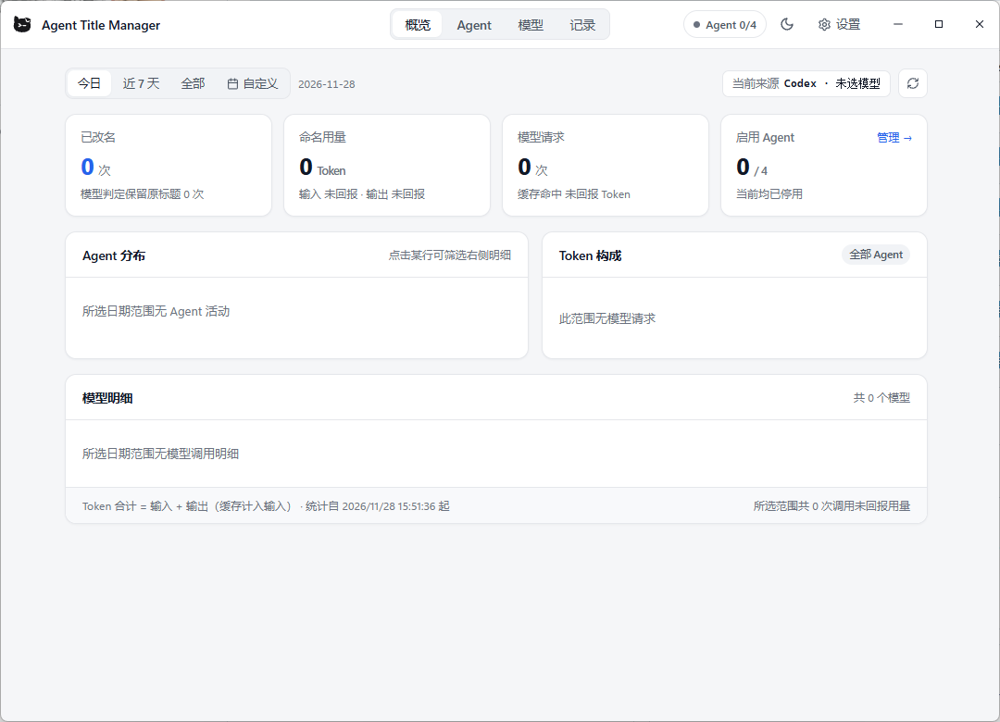
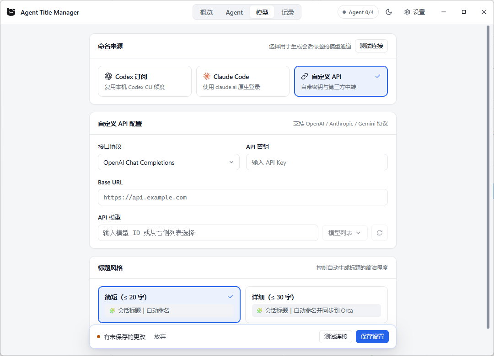
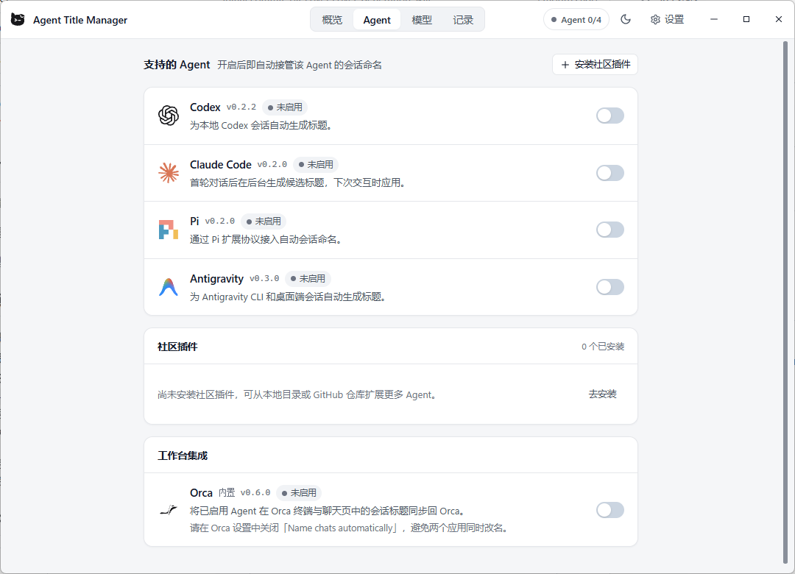

<p align="right">
  <a href="./README.md">English</a> · <strong>简体中文</strong>
</p>

<p align="center">
  
</p>

Agent Title Manager 是一款桌面应用，为 **Codex**、**Claude Code**、**Antigravity**（桌面端 & CLI）和 **Pi** 的会话自动生成统一结构（`类别 emoji + 对象｜核心目标`）的清晰标题，并支持本机用量统计、命名记录查看及 **Orca** 同步。

<p align="center">
  <a href="https://github.com/yyxxd/agent-title-manager/releases/latest">
    
  </a>
</p>

<p align="center">
  
</p>

## 三步开始

### 1. 下载安装

前往 [**最新版下载页面**](https://github.com/yyxxd/agent-title-manager/releases/latest) 下载安装包（当前提供 Windows x64 版本 `AgentTitleManager-*-windows-x64-setup.exe`，后续将逐步支持全平台；历史版本见[所有 Releases](https://github.com/yyxxd/agent-title-manager/releases)），安装后从开始菜单打开。

> 应用需要 **Microsoft Edge WebView2 Runtime**；Node.js 运行时已随安装包分发，无需额外配置。

### 2. 配置起标题的模型

在 **「模型」** 中选择 Codex 订阅、Claude Code 或自定义 API，选择模型并测试连接。
- 原生订阅直接复用对应 CLI 的登录状态。
- 自定义 API 支持 OpenAI Chat Completions、OpenAI Responses、Anthropic Messages 或 Gemini，填写服务地址和密钥即可。

<p align="center">
  
</p>

### 3. 开启要管理的工具

在 **「Agent」** 中开启需要管理的工具：
- **Codex**：若提示需要核准 Hook，请在 Codex 中运行 `/hooks` 审核通过，随后打开会话并完成一轮对话。
- **Claude Code**：完成第一轮对话后会在后台生成标题，发送下一条消息或重开会话时生效。
- **Orca（可选）**：使用 Orca 时，可在 **「工作台集成」** 中开启标题同步。

<p align="center">
  
</p>

关闭窗口后应用仍驻留系统托盘，可从托盘菜单或 **「设置」** 中退出。

---

<details>
<summary>统计口径与更新</summary>

- **概览统计**：按选择的范围展示本机已知的使用统计；Token 合计仅包含可获取的数据（输入 + 输出，缓存计入输入），缺失的数据不按零计算。测试连接请求不计入命名用量统计。
- **应用内更新**：在后台检查 GitHub 最新稳定版，确认后下载安装；更新前会验证 Ed25519 签名清单与安装包 SHA-256（签名配置见 [`docs/update-signing.md`](./docs/update-signing.md)）。手动覆盖安装前请先退出应用；卸载前建议先在「Agent」中停用集成并退出应用。

</details>

<details>
<summary>从源码构建 Windows x64 版本</summary>

准备 Go 1.26 或更新版本、Node.js 22+、pnpm 11、官方 Node.js Windows x64 解压目录，以及 NSIS 3.x。Node.js 解压目录应包含 `node.exe` 和 `LICENSE`。先按 Node.js 发布页附带的 SHA-256 清单验证下载。

```powershell
.\packaging\build.ps1 -NodeDistribution C:\tools\node-win-x64 -MakeNsis C:\tools\nsis\makensis.exe
```

- 更新应用图标时，替换 `internal/desktop/icon.png` 后运行 `go generate ./cmd/atm`，并提交两个架构的资源文件与 `packaging/app.ico`（安装程序和卸载程序使用）。
- 脚本执行前端构建和 Go 测试，将桌面可执行文件、bridge、内置插件和 Node.js 组装至 `out\windows-x64-*`，默认生成 `out\AgentTitleManager-<version>-windows-x64-setup.exe`（默认版本从 `internal/desktop/version.txt` 读取）。
- 测试可为桌面应用和 bridge 同时设置绝对路径 `ATM_DATA_DIR`，隔离 SQLite、WebView2 数据及命名管道。验证安装程序时使用独立目录，例如 `setup.exe /S /NoIntegration /D=C:\temp\atm-sandbox`。

</details>

<details>
<summary>插件通信协议</summary>

- 适配器启动 `atm-bridge.exe rpc`，在 stdin 提交一个 UTF-8 JSON 对象，在 stdout 读取一行响应。协议 v1 的命名方法是 `event.submit`、`title.claim` 和 `title.ack`，随附 Codex 适配器另用 `hook.observed` 报告当前注册的 Hook 运行状态。响应为 `{"ok":true,"result":...}` 或 `{"ok":false,"error":"..."}`。桌面未运行、插件未启用或超时后，适配器应继续原生会话。后台可在收到 `ingress_busy:` 时有限重试同一提交。收到 `ingress_pending` 时等待候选，无需重提事件。
- 社区插件可使用包含 `agent-title-plugin.json` 的本地目录，或指定 GitHub 仓库和完整提交 SHA。

</details>

## 许可与第三方说明

参见 [第三方声明](./plugins/THIRD_PARTY_NOTICES.md) 和 [命名引擎许可](./internal/engine/LICENSE.naming)。
